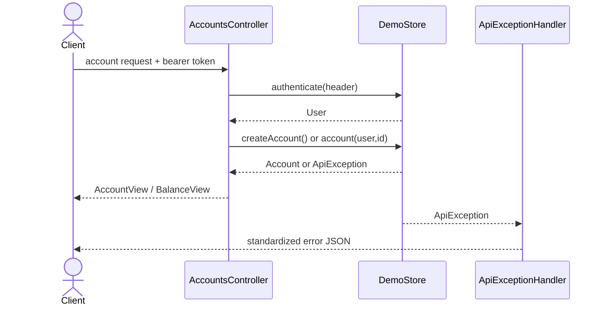

# Accounts API — implemented in-memory demo

## 1. Overview and contract

All routes require `Authorization: Bearer <token>`. `POST /api/accounts` creates an INR account (201). Optional body: `{ "initialBalance": 250.00 }`; omitted body/value means zero. Balance is nonnegative, up to two fractional digits. `GET /api/accounts/{accountId}` returns account ID, currency, and balance; `GET /api/accounts/{accountId}/balance` returns a focused balance response; both return 200. IDs must be UUIDs. Missing accounts are 404; another user's account is 403; missing/invalid token is 401; bad body/path is 400.

Example: `curl -X POST localhost:8080/api/accounts -H 'Authorization: Bearer <token>' -H 'Content-Type: application/json' -d '{"initialBalance":250.00}'` → `{"id":"<uuid>","currency":"INR","balance":250.00}`. For reads, use `curl localhost:8080/api/accounts/<uuid> -H 'Authorization: Bearer <token>'` and `curl localhost:8080/api/accounts/<uuid>/balance -H 'Authorization: Bearer <token>'`.

## 2–6. Actual flow and data

1. `api/accounts/AccountsController.create()` accepts an optional validated request record; `.get()` and `.balance()` bind UUID path values. Missing Authorization is accepted at binding, then rejected by `DemoStore.authenticate()` as 401.
2. Controllers authenticate the opaque token and receive `DemoStore.User`. `create()` defaults a missing balance to `BigDecimal.ZERO`, invokes `DemoStore.createAccount()`, and maps the immutable account record to a response DTO. `get()` and `balance()` invoke `DemoStore.account(user,id)`, which checks existence before ownership.
3. `DemoStore` stores UUID-keyed accounts in process memory. No repository/entity/table/database operation or persistent transaction is used; restart clears accounts. Initial balance is a demo convenience, not a deposit workflow.

`@Valid`, `@DecimalMin`, and `@Digits` are Jakarta validation features applied by Spring before controller execution. `ApiExceptionHandler` standardizes domain and validation errors. Missing/forbidden states throw `ApiException`, not null.

## 7. Failures

400 invalid UUID/body or validation; 401 missing/unknown token; 403 account belongs to another user; 404 unknown account; unexpected failures use Spring's 500 handling. No database tables are accessed.

## 8. Sequence

## 9. Worked example

A valid token and `{ "initialBalance": 250.00 }` make `create()` store an in-memory account for the token owner and respond 201. A later balance request passes the user and UUID to `account()` and returns `{"accountId":"<uuid>","currency":"INR","balance":250.00}`.

## 10. Verification

Compilation verified with `mvn -DskipTests compile` (BUILD SUCCESS; eight source files compiled). Runtime startup was attempted with DB variables unset, but Spring Boot Maven plugin dependencies could not be downloaded due unavailable network access. No HTTP requests or tests were run.
