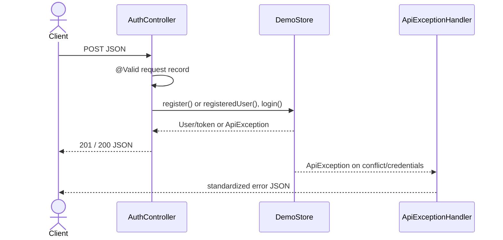

# Authentication API — implemented in-memory demo

## 1. Overview and contract

`POST /api/auth/register` creates a user (201); `POST /api/auth/login` checks credentials and returns a bearer token (200). Both accept `{ "email": "asha@example.com", "password": "demoPass123" }`. Email must be valid and at most 320 characters; password is 8–128 characters. Email comparison is case-insensitive. Success responses omit password/hash. Duplicate email is 409; invalid login is 401; invalid JSON/fields are 400. Tokens are random opaque process-memory tokens: no expiry, refresh, logout, or durable revocation exists. Passwords use salted PBKDF2WithHmacSHA256. Use the login response token as `Authorization: Bearer <token>`.

## 2–6. Actual request path and data

1. Spring routes to `api/auth/AuthController.register()` or `.login()`. Jackson creates the nested request record; `@Valid`, `@Email`, `@NotBlank`, and `@Size` validate it before method execution.
2. Registration trims the email and calls `demo/DemoStore.register(email,password)`. The synchronized method normalizes the key, rejects duplicates with `ApiException(409,...)`, derives a salted 256-bit PBKDF2 hash (120,000 iterations), stores a `User` in memory, and returns it. Login obtains response identity with `registeredUser()` then calls `login()` to verify the hash with `MessageDigest.isEqual` and create a random token mapping.
3. The controller maps user/token values to response records and Spring serializes JSON. No repository, entity, table, database operation, or database transaction participates. All state is temporary and lost on restart.

`registeredUser` and `login` use the same 401 for absent users and incorrect passwords. PBKDF2 setup failures become `IllegalStateException`; `ApiExceptionHandler` maps domain and validation errors to `{timestamp,status,code,message,details}`. Unexpected errors use Spring's 500 handling.

## 7. Failures

400 `VALIDATION_ERROR`/`MALFORMED_REQUEST`; 401 `INVALID_CREDENTIALS`; 409 `EMAIL_ALREADY_REGISTERED`; unexpected server errors are 500. Database effects: none.

## 8. Sequence

## 9. Worked example

Registration JSON becomes `Registration`; after validation, the store hashes the password and returns a UUID/email pair. Login verifies the hash and returns `{ "accessToken":"<token>", "tokenType":"Bearer", "user":{"id":"<uuid>","email":"asha@example.com"}}`.

## 10. Verification

Compilation verified with `mvn -DskipTests compile` (BUILD SUCCESS; eight source files compiled). Runtime startup was attempted with DB variables unset, but Spring Boot Maven plugin dependencies could not be downloaded due unavailable network access. No HTTP requests or tests were run.
