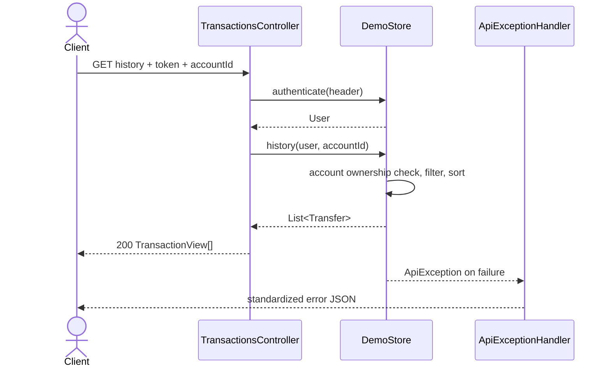

# Transaction history API — implemented in-memory demo

## 1. Overview and contract

`GET /api/transactions?accountId=<uuid>` requires `Authorization: Bearer <token>` and returns a JSON array of transfers where that account is source or destination, newest first. Empty history is `200 []`. Only the account owner may query. Missing account is 404, other owner's account 403, missing/invalid token 401, malformed UUID/missing query parameter 400. A row contains transfer ID, source/destination account IDs, amount, currency, status, and createdAt.

Example: `curl 'localhost:8080/api/transactions?accountId=<uuid>' -H 'Authorization: Bearer <token>'`.

## 2–6. Actual flow and data

1. Spring routes to `api/transactions/TransactionsController.history(authorization,accountId)` and converts query text to UUID. Controller authenticates with `DemoStore.authenticate()` then calls `DemoStore.history(user,accountId)`.
2. The synchronized store calls `account(user,accountId)` to enforce existence and ownership, filters its in-memory transfer map for either side matching the account, sorts creation times descending, and returns a list. Controller maps each `DemoStore.Transfer` to `TransactionView` and returns it; Spring serializes the list.
3. No database table, repository, entity, or query is used. This history lasts only until process restart. Current response is unpaginated; pagination/filter choices were TBD and are assumed unnecessary for the Phase 1 demo.

## 7. Failures

400 invalid/missing accountId; 401 absent/invalid bearer token; 403 non-owner; 404 unknown account; unexpected 500. No database effects occur.

## 8. Sequence

## 9. Worked example

If account A participated in two transfers, the method returns both with the newest first. It includes incoming and outgoing transfers and exposes no unrelated account history.

## 10. Verification

Compilation verified with `mvn -DskipTests compile` (BUILD SUCCESS; eight source files compiled). Runtime startup was attempted with DB variables unset, but the Spring Boot Maven plugin dependency download was blocked by network access; no HTTP request or tests were run.
