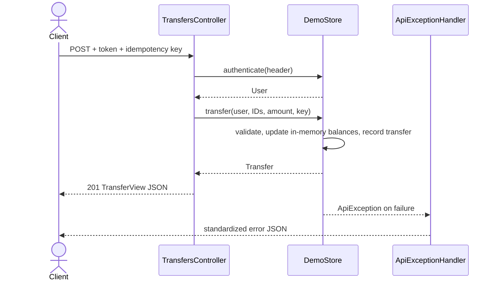

# Transfers API — implemented in-memory demo

## 1. Overview and contract

`POST /api/transfers` requires a bearer token, `Idempotency-Key` (1–128 characters), and JSON `{ "sourceAccountId":"<uuid>", "destinationAccountId":"<uuid>", "amount":25.50 }`. It returns 201 with transfer ID, endpoints, amount, INR, `COMPLETED`, and creation time. Amount must be positive with at most two decimals. `GET /api/transfers/{transferId}` returns the transfer only to the owner of its source account (200). Errors: 400 invalid input/same account/key; 401 authentication; 403 source ownership; 404 missing account/transfer; 409 insufficient funds or key reused with a different payload.

Example:

```sh
curl -X POST localhost:8080/api/transfers -H 'Authorization: Bearer <token>' -H 'Idempotency-Key: transfer-001' -H 'Content-Type: application/json' -d '{"sourceAccountId":"<source>","destinationAccountId":"<destination>","amount":25.50}'
```

Check status with `curl localhost:8080/api/transfers/<transfer-uuid> -H 'Authorization: Bearer <token>'`.

## 2–6. Actual flow and data

1. `api/transfers/TransfersController.create()` receives the optional Authorization and Idempotency-Key headers plus validated `CreateTransfer`; Spring/Jackson bind UUID and `BigDecimal` values. `@NotNull`, `@DecimalMin`, and `@Digits` reject invalid body values before execution. Controller calls `DemoStore.authenticate()` then `DemoStore.transfer(user,source,destination,amount,key)`.
2. The synchronized store validates the key, checks a prior user-scoped key and payload, verifies source ownership and destination existence, rejects same-account and insufficient funds, and replaces both immutable account records with adjusted balances. It then creates a completed `Transfer` and one in-memory `DEBIT` plus one `CREDIT` `LedgerEntry`, using the same transfer ID and amount, and indexes it by key. The synchronization serializes calls only within this single JVM. Replay of the same payload returns the original transfer; the controller still responds 201.
3. The controller maps the store record into `TransferView`; Spring writes JSON. `get()` authenticates and asks the store for the transfer; store verifies source-account ownership. There are no repositories, JPA entities, database rows, durable idempotency, or database rollback. The two ledger entries are also temporary in-memory records. State vanishes at restart. The synchronized in-memory update is not evidence of durable financial atomicity or multi-instance concurrency safety.

`BigDecimal.compareTo()` compares numeric amount without scale-sensitive equality; subtract/add produce new immutable values. `ApiException` propagates to `ApiExceptionHandler`; no controller suppresses errors.

## 7. Failures

400 validation, same account, missing/invalid idempotency key; 401 missing/invalid token; 403 caller does not own source account; 404 account or transfer absent; 409 insufficient balance or key payload conflict; unexpected 500. Failed validation/business checks happen before balance changes. No database transaction exists.

## 8. Sequence



## 9. Worked example

With source balance 100.00 and destination 0.00, amount 25.50 makes balances 74.50 and 25.50 and records one completed transfer. Repeating the same key and payload returns the same transfer without another debit. Reusing it for 30.00 gives 409. These effects exist only in memory.

## 10. Verification

Compilation verified with `mvn -DskipTests compile` (BUILD SUCCESS; eight source files compiled). Runtime startup was attempted with DB variables unset, but the Spring Boot Maven plugin could not resolve dependencies due network access; no HTTP request or tests were run, so transfer behavior is not runtime-verified.
